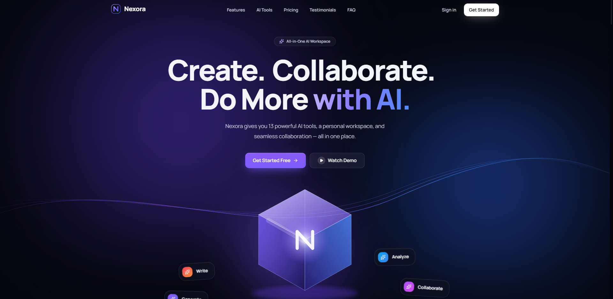
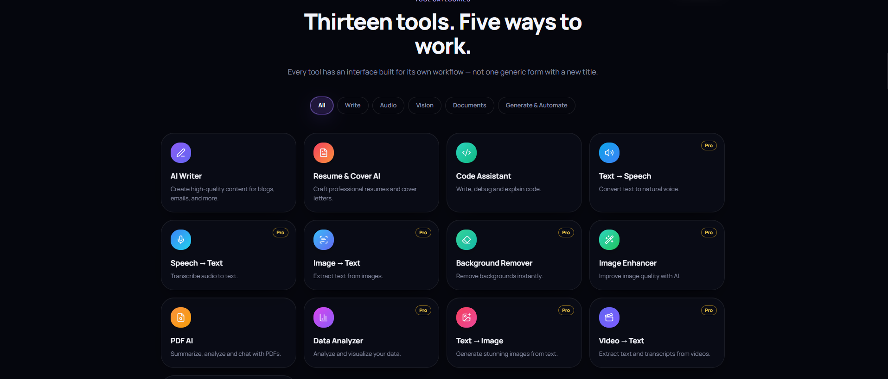
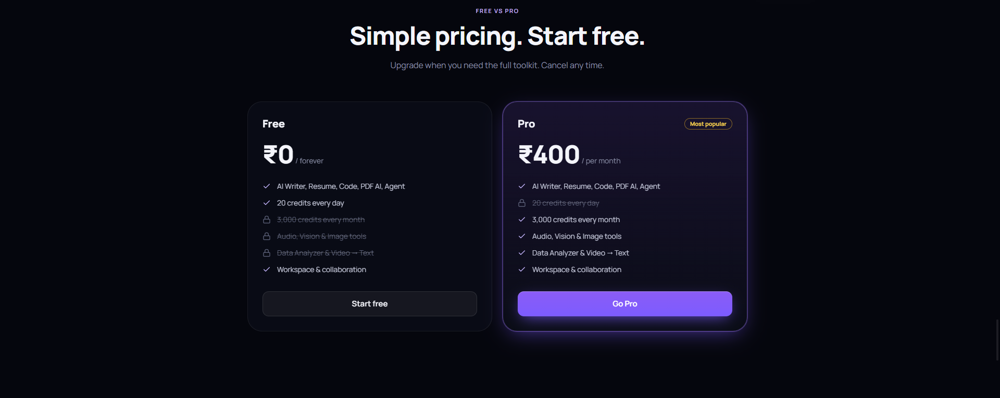
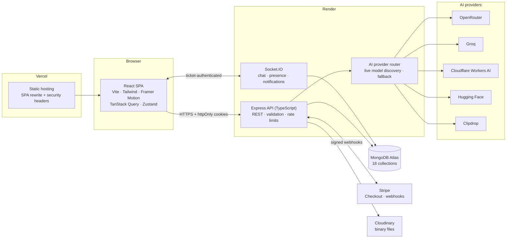
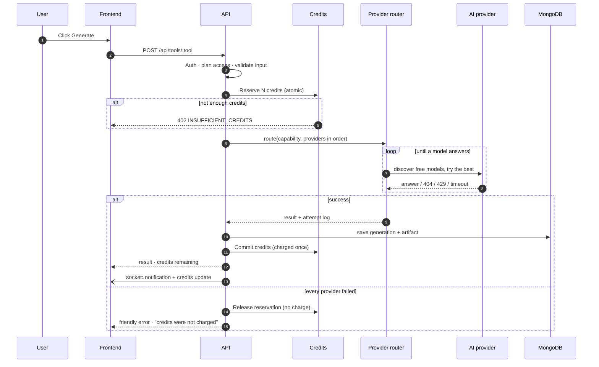
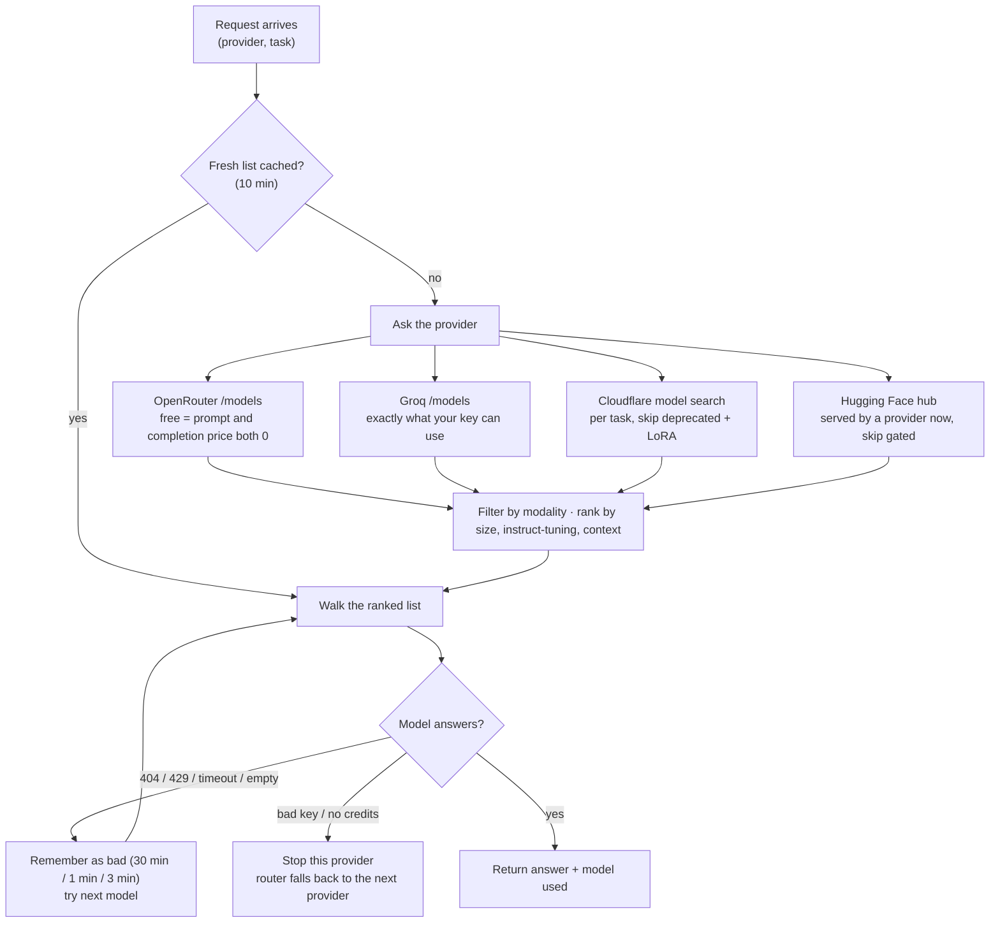
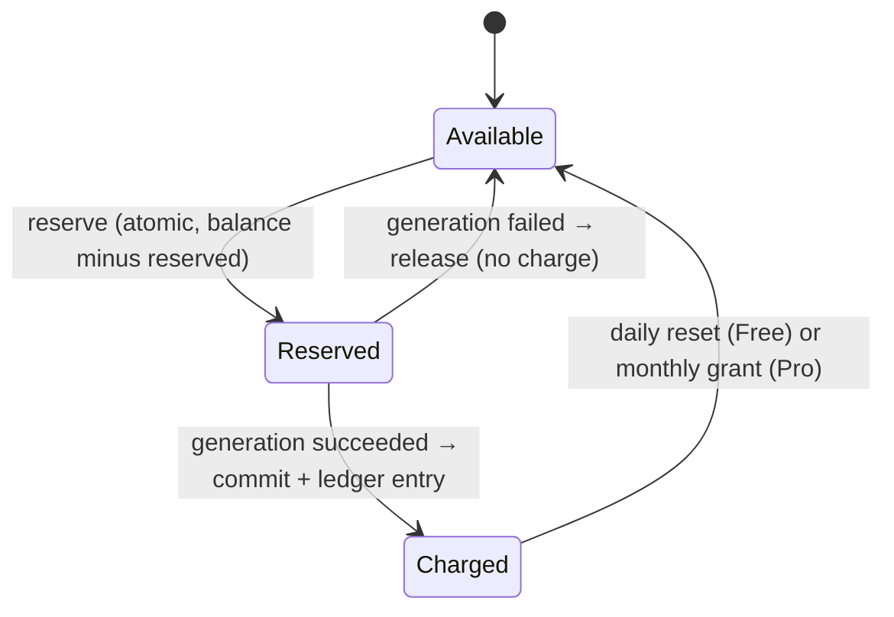
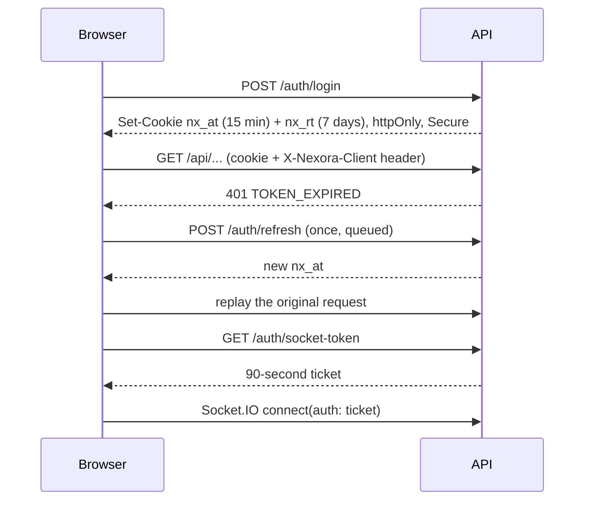

<div align="center">


# Nexora



### Create. Collaborate. Do more with AI.

**An all-in-one AI workspace — 13 AI tools, a personal workspace, real-time collaboration, Stripe billing and a full admin console.**


<br/>


</div>

---

## Table of contents

1. [What is Nexora?](#what-is-nexora)
2. [Highlights](#highlights)
3. [Screenshots](#screenshots)
4. [Features in detail](#features-in-detail)
5. [Admin console](#admin-console)
6. [Architecture](#architecture)
7. [Tech stack](#tech-stack)
8. [Project structure](#project-structure)
9. [Getting started (clone & run)](#getting-started-clone--run)
10. [Environment variables](#environment-variables)
11. [API reference](#api-reference)
12. [Testing](#testing)
13. [CI/CD](#cicd)
14. [Deployment guide (Render + Vercel + Stripe)](#deployment-guide-render--vercel--stripe)
15. [Security](#security)
16. [Design system](#design-system)
17. [Troubleshooting](#troubleshooting)
18. [Known limitations](#known-limitations)
19. [Scripts cheat-sheet](#scripts-cheat-sheet)
20. [Contributing · License · Author](#contributing)

---

## What is Nexora?

Nexora is a full-stack SaaS application that puts everything you do with AI in one place. Instead of juggling a writing app, a transcription site, an image editor and a chatbot, you open one workspace:

- pick from **13 purpose-built AI tools** (each has its own interface, not one generic form),
- keep every result as a **file in your workspace** that you can preview, edit, export and share,
- **collaborate** with other users as viewer or editor,
- pay **₹400/month** for Pro through **Stripe**, and
- run the whole platform from an **admin console** with analytics, user management, provider health, support chat and an audit trail.

Behind the scenes Nexora is **provider-agnostic**: requests are routed across **OpenRouter, Groq, Cloudflare Workers AI, Hugging Face and Clipdrop**, and the model for each request is **discovered live** — there are no hardcoded model names, so a provider retiring a model never takes a tool down.

> **Free to start.** Five tools are free with 20 credits every day. Pro unlocks all 13 tools and a monthly credit pool.

## Highlights

| | |
|---|---|
| 🧰 **13 AI tools** | Writer, Resume & Cover, Code, PDF AI, Agent, Text→Speech, Speech→Text, Image→Text, Background Remover, Image Enhancer, Data Analyzer, Text→Image, Video→Text |
| 🔀 **Live provider routing** | Free models are discovered from each provider at request time; dead models are skipped; providers fall back automatically; one generation is charged once |
| 💳 **Credits that can’t overspend** | Atomic reserve → commit/release; failures are never charged; free credits reset daily, Pro monthly; every change is a ledger entry |
| 📄 **PDF AI with citations** | Page-aware chunking, embeddings, vector or cosine retrieval, answers cite `[p3]`; works on documents shared with you |
| 🗂 **Workspace** | Every result is an artifact with in-app viewers (text editor, PDF, image, audio, video, charts, résumé) |
| 🤝 **Collaboration** | Share by name or email as **viewer** or **editor**; download rights; real-time updates |
| 💬 **Support** | Tracked reports with attachments **and** live admin chat with typing, read receipts and presence |
| 🛡 **Admin console** | 8 sections: dashboard, users, AI management, billing & plans, support, communication, analytics, system & audit |
| 🎬 **Cinematic UI** | First-visit intro, 3D tilt cards, magnetic buttons, spotlight hover, `prefers-reduced-motion` respected |
| 🔐 **Security-first** | httpOnly cookies, token versioning, lockout, CSRF header, SSRF guard, magic-byte uploads, prompt-injection fencing, audit log |
| ✅ **177 automated tests** | 143 backend + 34 frontend, running with no database and no API keys |

## Pages

> The production build ships with the following pages and screens, each captured at 1440 × 900 unless noted.

| Page | What it shows |
|---|---|
| **Cinematic intro** | First visit only, skippable — ambient light, the logo draws itself, a progress line with status text, then two dark curtains part on a seam of light. |
| **Onboarding** | Three animated questions followed by a personalised summary and recommended tools. Never shown again once finished. |
| **Dashboard** | Credit balance and reset date, quick-access tools, recent activity, and a 14-day usage chart. |
| **AI Tools** | All 13 tools grouped by category with search and Free / Pro badges. |
| **AI Writer** | Editable result pane with copy, PDF export, share and favourite actions. |
| **Pro gate** | A real Pro tool page rendered behind an upgrade card — same layout, locked content. |
| **Billing** | Current plan, credit meter, renewal date, Stripe upgrade / cancel / resume, plus credit, subscription and payment histories. |
| **Notifications** | Full-page view with an unread filter, mark-read, mark-all-read and delete; new items arrive live over the socket. |
| **Admin dashboard** | Total / Free / Pro users, generations today, credits consumed, revenue, active providers, failed requests, open reports, a 14-day generation trend and live provider health. |
| **Admin — AI management** | Per-provider status, success rate, average latency, fallback counts, last error, per-tool usage, and every generation with its provider attempt log. |
| **Admin — Users** | Search and filter by plan and status; per-user usage, credit history, billing, reports and collaboration; credits, plan, activation and deletion controls. |
| **Mobile dashboard** | Fully responsive down to 360 px — collapsible sidebar becomes a drawer, tables become cards. |
| **Landing — tool showcase** | One of the 15 landing sections; lists every tool with a short description. |
| **Landing — pricing** | Free vs Pro comparison with the ₹400/month Stripe checkout entry point. |

---

## Pages at a glance

- **Public** — Landing · Intro · Login · Register · Forgot password · Reset password
- **Onboarding** — Three-step questionnaire (once, after sign-up)
- **App** — Dashboard · AI Tools · each of the 13 tool pages · Workspace · History · Billing · Collaboration · Notifications · Support · Profile
- **Admin** — `/admin/login` · Dashboard · Users · AI Management · Billing & Plans · Support · Communication · Analytics · System & Audit

---

## Features in detail

### The 13 AI tools

Every tool has a purpose-built interface, shows its **credit cost before you run**, streams **live status** while it works, and saves its output as an artifact.

| # | Tool | Plan | Credits | Provider order | What it does |
|---|---|:---:|:---:|---|---|
| 1 | **AI Writer** | Free | 2 | OpenRouter → Groq → Cloudflare → Hugging Face | Blog, email, essay, social, story, product copy, speech, summary · tone · length · language · in-app editor |
| 2 | **Resume & Cover AI** | Free | 3 | same as above | Section-by-section résumé builder or cover letter · optional job description · modern / classic / minimal formats · ATS-friendly output · PDF export |
| 3 | **Code Assistant** | Free | 2 | same as above | Explain · Debug · Improve · Generate · Refactor · 12 languages · syntax-friendly blocks with one-click copy |
| 4 | **PDF AI** | Free | 3 | same as above | Upload a PDF, then ask, summarize, extract or analyze · page citations · inline PDF preview · works on PDFs shared with you |
| 5 | **AI Agent** | Free | 5 | same as above | Plans up to 3 steps, uses PDF AI when a document is attached, shows safe high-level status (never raw reasoning) |
| 6 | **Text → Speech** | Pro | 3 | Cloudflare → Hugging Face | Natural voice in 6 languages · speed control · waveform player · download |
| 7 | **Speech → Text** | Pro | 3 | Groq → Cloudflare → Hugging Face | Upload **or record in the browser** · timestamped segments · copy / PDF export |
| 8 | **Image → Text** | Pro | 2 | OpenRouter → Cloudflare → Hugging Face | OCR or description · upload **or public URL** (SSRF-guarded) |
| 9 | **Background Remover** | Pro | 4 | Clipdrop | Transparent PNG · draggable before/after slider |
| 10 | **Image Enhancer** | Pro | 4 | Clipdrop | 2× / 4× upscale (capped at 4096 px) · before/after slider |
| 11 | **Data Analyzer** | Pro | 4 | OpenRouter → Groq → Cloudflare → Hugging Face | CSV / TSV / JSON · stats, outliers and correlations **computed server-side** · charts that explain the data · AI insights that only use those numbers |
| 12 | **Text → Image** | Pro | 5 | Cloudflare → Hugging Face | 5 aspect ratios · 6 styles · negative prompt · full-screen viewer |
| 13 | **Video → Text** | Pro | 6 | Groq → Cloudflare → Hugging Face | MP4 / WebM up to 25 MB · timestamped transcript |

Costs and plan access are **defaults** — admins can change both (and disable a tool) at runtime without a deploy.

### Free vs Pro

| | **Free** | **Pro — ₹400 / month** |
|---|---|---|
| Tools | Writer · Resume & Cover · Code · PDF AI · Agent | **All 13** |
| Credits | **20 per day** (reset, not accumulated) | **3,000 per month** |
| Workspace, history, collaboration, support | ✔ | ✔ |
| Priority | — | Same routing, bigger allowance |

Plan checks happen **on the server for every request**. The locked-tool screen in the UI is a convenience, not the guard.

### Credits

- **Free** users get a fresh balance at midnight (default IST, configurable with `CREDIT_RESET_OFFSET_MINUTES`) — unused credits do not roll over.
- **Pro** users receive a monthly grant when their period renews.
- A request **reserves** credits atomically, so two parallel requests can never spend the same balance. Credits are **committed only after success**; on failure the reservation is released and **nothing is charged**.
- A provider fallback inside one request is still **one generation, one charge**.
- Every change (daily reset, monthly grant, generation, admin adjustment, refund) is stored in a **credit ledger** with before/after balances, visible to the user (Billing → Credit usage) and to admins.

### Workspace & artifacts

Every output is an **artifact** with the right viewer: Markdown editor, résumé preview, code blocks, PDF viewer, image viewer with full-screen, audio player with waveform, video player, and data dashboards with charts and tables.

- Tabs: **My Artifacts · My Files · Recent · Favorites · Shared with me**
- Search, category filter, sort, grid/list view, pagination
- Upload your own images, audio, video and PDFs
- Rename inline, favorite, download, export as PDF, share, delete (actions adapt to the file type and your role)

### Collaboration

- Share an artifact with any Nexora user **by name or email** (with autocomplete suggestions).
- **Viewer** — can read, and download only if the owner allows it. **Editor** — can edit text and rename; always able to download. Only the **owner** can delete, favorite or manage access.
- Owners can change permissions or revoke at any time; collaborators can leave.
- Invitations, permission changes and edits create **notifications** and push **real-time updates**.
- Collaborators can chat with a **shared PDF** in PDF AI.

### History

Every generation with tool, title, date, credits, provider (and whether a fallback was used), and status. Filter by tool, status, date range or favorites; search by title; **export to PDF or JSON**; re-run a tool in one click; delete entries.

### Billing

Current plan, credit meter, renewal date, **Upgrade** (Stripe Checkout), **Cancel / Resume** (at period end), **customer portal** for payment methods, plus credit-usage, subscription and payment histories. After checkout, the app asks the server to **confirm with Stripe directly**, so you become Pro even before the webhook arrives — and a **"Paid already? Refresh my plan"** link repairs any account whose webhook was missed.

### Support

- **Reports** — category, subject, description, up to 3 attachments; statuses *Open → In Progress → Resolved → Reopened → Closed*; threaded replies and a status history.
- **Live chat with admin** — real-time messages, typing indicator, sent/read receipts, admin presence, unread badge in the sidebar.

### Notifications

Bell dropdown + full page with unread filter, mark-read, mark-all-read and delete. Triggers include: generation complete, file generated, document ready, download completed, report replies and status changes, admin messages and announcements, subscription and payment events, and collaboration invites/updates. New items arrive over the socket without a refresh.

### Account & security

Profile (name, phone, email, avatar upload), password change, **recovery code** regeneration, account deletion (erases everything you own), lockout after repeated failures, and session revocation on password change.

### Intro, landing & onboarding

- **Cinematic intro** (first visit only, skippable): ambient light, the logo draws itself, a progress line with status text, then two dark curtains part on a seam of light.
- **15-section landing page**: nav, hero with 3D prism, stats, provider ecosystem, features, tool showcase, how it works, Free vs Pro, workspace, collaboration, artifact management, provider routing, product preview, pricing, testimonials, FAQ, final CTA, footer.
- **Onboarding** (once, after sign-up): three animated questions → a personalised summary and recommended tools; it never reappears after you finish it.

---

## Admin console

Sign in at **`/admin/login`** with `ADMIN_EMAIL` / `ADMIN_PASSWORD` from the backend environment. There is **no admin registration route**; the admin session is a separate cookie from user sessions and lasts 2 hours.

| Section | What you can do |
|---|---|
| **Dashboard** | Total / free / pro users, generations today, credits consumed, revenue, active providers, failed requests, open reports, 14-day generation trend, provider health, recent generations — updating live |
| **Users** | Search & filter (plan, status), full user detail (usage per tool, generations, credit history, billing, reports, collaboration), **adjust credits** (logged), **change plan**, **activate / deactivate**, **delete user + data** |
| **AI Management** | Per-provider status (healthy / degraded / unavailable), success rate, average latency, fallback counts, last error; per-tool usage; all generations with the **provider attempt log**; failed generations |
| **Billing** | Revenue (all time / 30 days), subscriptions, payments, credit transactions, and the **Plans & credits editor**: Free/Pro allowances, per-tool credit cost, per-tool plan access, enable/disable a tool |
| **Support** | Reports queue (search, status filter, reply, reply-and-resolve, status changes) and a **live chat inbox** with unread counts, presence and typing |
| **Communication** | Announcements to everyone / Free / Pro / selected users, **scheduling**, edit and delete; send a system notification to one user; notification statistics |
| **Analytics** | 7/30/90-day charts: user growth, daily active users, generations & failures, credits, tool popularity, provider usage, Free vs Pro, revenue, subscription growth, conversion; **PDF export** |
| **System** | Uptime & environment, provider health, API error log, recent activity feed, switches (registration, live chat, **maintenance mode**), and the **audit log** (search, PDF/JSON export) |

Global search in the top bar finds users, generations, reports, audit entries and credit transactions. Every sensitive admin action (credits, plan, activation, deletion, plan edits, announcements, report status) is written to the **audit log**.

---

## Architecture

### System overview



### How a generation works

Every tool goes through the same pipeline (`backend/src/services/ai.service.ts`):



### Dynamic model discovery (no hardcoded models)

Model names change constantly, so Nexora **never stores one**. For each request the adapter asks the provider what is available *right now*:



- If discovery itself fails, the last known list is reused for up to 6 hours.
- If every model is marked bad (for example a burst of 429s), they are retried rather than locking the provider out.
- A **100-second budget** per request keeps the browser from timing out first.
- Cloudflare requests are shaped from each model's **own input schema**, because Workers AI models accept different fields.
- **OpenRouter note:** free models answer `404 … data policy` until you allow free endpoints at *openrouter.ai → Settings → Privacy*.

### Credit lifecycle



### Authentication & sessions



- **Cookies:** cross-site deployments (`vercel.app` + `onrender.com`) use `SameSite=None; Secure`; a shared custom domain can use first-party `lax` cookies via `COOKIE_DOMAIN`.
- **Revocation:** every user has a `tokenVersion`; changing the password or deactivating the account invalidates all existing sessions immediately.
- **Account recovery without email:** a one-time **recovery code** is shown at sign-up (only its hash is stored). Email + code → 10-minute reset token → new password (which rotates the code).
- **CSRF:** state-changing requests must carry `X-Nexora-Client`; a browser can only send it after a CORS preflight, which the origin allow-list controls.

### PDF AI (RAG)

1. **Upload** → magic-byte check → per-page text extraction (up to 300 pages) → stored in Cloudinary.
2. **Chunk** per page with overlap (≈900 characters), keeping page numbers.
3. **Embed** with a live provider model (Hugging Face → Cloudflare) or a deterministic local embedder; the **embedding model is stored on the document** and every later query uses the same model.
4. **Retrieve** with MongoDB Atlas `$vectorSearch` when enabled, otherwise exact cosine ranking — and plain keyword ranking if the document's embedding model is unreachable.
5. **Answer** with the top excerpts fenced as untrusted data; the model must cite pages like `[p3]`.

Atlas index (optional): collection `docchunks`, name `ATLAS_VECTOR_INDEX`, vector field `embedding` with the dimensions of your embedding model, filter field `documentId`.

### Data model

18 collections (Mongoose, 14 model files):

| Collection | Purpose |
|---|---|
| `users` | Account, plan, credits, reserved credits, token version, lockout, onboarding answers, Stripe customer id |
| `generations` | One row per run: tool, input summary, output, provider, model, status, credits, latency, **attempt log** |
| `artifacts` | Files and results with owner, kind, content or storage reference, tags, favorite |
| `credittransactions` | Credit ledger (reset, grant, generation, admin adjustment, refund) |
| `subscriptions` · `payments` · `stripeevents` | Stripe state, invoices, and the webhook idempotency ledger |
| `notifications` | In-app notifications (auto-expire after 90 days) |
| `reports` · `messages` | Support reports (with history) and the user↔admin chat |
| `collaborations` | Artifact sharing: owner, collaborator, permission, download right |
| `announcements` | Admin announcements, audience, schedule, recipient count |
| `providerhealths` | Per-provider request/success/failure/latency counters |
| `auditlogs` | Admin action trail |
| `settings` · `errorlogs` | Runtime overrides (plans, tool costs, switches) and server errors (auto-expire after 30 days) |
| `documents` · `docchunks` | PDF AI documents and their embedded chunks |

### Real-time events

Socket.IO authenticates with a short-lived ticket (cookie fallback).

| Event | Direction | Purpose |
|---|---|---|
| `notification:new` | server → user | New notification |
| `credits:update` | server → user | Fresh balance after a generation |
| `generation:progress` | server → user | Live status label ("Drafting", "Using PDF AI…") |
| `collab:update` | server → user | A shared artifact changed |
| `chat:send` / `chat:message` | both | Send / receive chat messages |
| `chat:typing` · `chat:read` | both | Typing indicator and read receipts |
| `presence:admin` · `presence:user` | server → user / admins | Online status |
| `admin:event` | server → admins | Registrations, reports, generations, payment failures |

---

## Tech stack

| Layer | Technology |
|---|---|
| **Frontend** | React 18, Vite 5, TypeScript, Tailwind CSS 3, Framer Motion, TanStack Query, Zustand, React Hook Form + Zod, Recharts, Radix primitives (shadcn-style components), react-markdown, Socket.IO client, Manrope + JetBrains Mono |
| **Backend** | Node ≥ 18, Express 4, TypeScript (strict), Mongoose 8, Zod, Socket.IO, JSON Web Tokens, bcryptjs, Helmet, express-rate-limit, Multer, pdfkit, pdf-parse, PapaParse |
| **Data & files** | MongoDB (Atlas), Cloudinary (local disk in development) |
| **Payments** | Stripe Checkout, webhooks, customer portal |
| **AI** | OpenRouter, Groq, Cloudflare Workers AI, Hugging Face, Clipdrop |
| **Quality** | Jest, ts-jest, Supertest, Testing Library, ESLint (typescript-eslint), GitHub Actions, gitleaks |
| **Hosting** | Render (API), Vercel (web), MongoDB Atlas |

---

---

## Project structure

<details open>
<summary><b>File tree</b></summary>

```text
├── 📁 .github
│   └── 📁 workflows
│       ├── ⚙️ ci.yml
│       └── ⚙️ deploy.yml
├── 📁 backend
│   ├── 📁 scripts
│   │   └── 📄 stripe-setup.ts
│   ├── 📁 src
│   │   ├── 📁 config
│   │   │   ├── 📄 env.ts
│   │   │   └── 📄 tools.ts
│   │   ├── 📁 controllers
│   │   │   ├── 📄 admin.controller.ts
│   │   │   ├── 📄 artifact.controller.ts
│   │   │   ├── 📄 auth.controller.ts
│   │   │   ├── 📄 billing.controller.ts
│   │   │   ├── 📄 support.controller.ts
│   │   │   ├── 📄 tools.controller.ts
│   │   │   └── 📄 user.controller.ts
│   │   ├── 📁 middleware
│   │   │   ├── 📄 auth.ts
│   │   │   ├── 📄 errorHandler.ts
│   │   │   ├── 📄 rateLimit.ts
│   │   │   ├── 📄 upload.ts
│   │   │   └── 📄 validate.ts
│   │   ├── 📁 models
│   │   │   ├── 📄 Announcement.ts
│   │   │   ├── 📄 Artifact.ts
│   │   │   ├── 📄 AuditLog.ts
│   │   │   ├── 📄 Collaboration.ts
│   │   │   ├── 📄 CreditTransaction.ts
│   │   │   ├── 📄 Document.ts
│   │   │   ├── 📄 Generation.ts
│   │   │   ├── 📄 Message.ts
│   │   │   ├── 📄 Notification.ts
│   │   │   ├── 📄 ProviderHealth.ts
│   │   │   ├── 📄 Report.ts
│   │   │   ├── 📄 Setting.ts
│   │   │   ├── 📄 Subscription.ts
│   │   │   └── 📄 User.ts
│   │   ├── 📁 routes
│   │   │   ├── 📄 admin.routes.ts
│   │   │   ├── 📄 auth.routes.ts
│   │   │   ├── 📄 support.routes.ts
│   │   │   ├── 📄 tools.routes.ts
│   │   │   └── 📄 user.routes.ts
│   │   ├── 📁 services
│   │   │   ├── 📁 providers
│   │   │   │   ├── 📄 catalog.ts
│   │   │   │   ├── 📄 clipdrop.ts
│   │   │   │   ├── 📄 cloudflare.ts
│   │   │   │   ├── 📄 groq.ts
│   │   │   │   ├── 📄 http.ts
│   │   │   │   ├── 📄 huggingface.ts
│   │   │   │   ├── 📄 index.ts
│   │   │   │   ├── 📄 mock.ts
│   │   │   │   ├── 📄 openrouter.ts
│   │   │   │   └── 📄 types.ts
│   │   │   ├── 📁 tools
│   │   │   │   ├── 📄 data.tool.ts
│   │   │   │   ├── 📄 helpers.ts
│   │   │   │   ├── 📄 media.tools.ts
│   │   │   │   ├── 📄 pdf.tool.ts
│   │   │   │   ├── 📄 schemas.ts
│   │   │   │   └── 📄 text.tools.ts
│   │   │   ├── 📄 ai.service.ts
│   │   │   ├── 📄 artifact.service.ts
│   │   │   ├── 📄 audit.service.ts
│   │   │   ├── 📄 credit.service.ts
│   │   │   ├── 📄 notification.service.ts
│   │   │   ├── 📄 pdf.service.ts
│   │   │   ├── 📄 providerRouter.ts
│   │   │   ├── 📄 rag.service.ts
│   │   │   ├── 📄 scheduler.ts
│   │   │   ├── 📄 settings.service.ts
│   │   │   ├── 📄 storage.service.ts
│   │   │   ├── 📄 stripe.service.ts
│   │   │   └── 📄 userPurge.service.ts
│   │   ├── 📁 sockets
│   │   │   ├── 📄 index.ts
│   │   │   ├── 📄 io.ts
│   │   │   └── 📄 presence.ts
│   │   ├── 📁 utils
│   │   │   ├── 📄 asyncHandler.ts
│   │   │   ├── 📄 dates.ts
│   │   │   ├── 📄 errors.ts
│   │   │   ├── 📄 imageSize.ts
│   │   │   ├── 📄 logger.ts
│   │   │   ├── 📄 promptGuard.ts
│   │   │   ├── 📄 sanitize.ts
│   │   │   ├── 📄 sniff.ts
│   │   │   ├── 📄 ssrf.ts
│   │   │   └── 📄 tokens.ts
│   │   ├── 📄 app.ts
│   │   ├── 📄 server.ts
│   │   └── 📄 types.d.ts
│   ├── 📁 tests
│   │   ├── 📄 api.test.ts
│   │   ├── 📄 billing-sync.test.ts
│   │   ├── 📄 collab.test.ts
│   │   ├── 📄 config.test.ts
│   │   ├── 📄 cors.cookies.test.ts
│   │   ├── 📄 credits.test.ts
│   │   ├── 📄 models.test.ts
│   │   ├── 📄 router.test.ts
│   │   ├── 📄 setup.ts
│   │   ├── 📄 stripe.test.ts
│   │   └── 📄 utils.test.ts
│   ├── ⚙️ .gitignore
│   ├── 🐳 Dockerfile
│   ├── 📄 eslint.config.mjs
│   ├── 📄 jest.config.js
│   ├── ⚙️ package-lock.json
│   ├── ⚙️ package.json
│   ├── ⚙️ render.yaml
│   └── ⚙️ tsconfig.json
├── 📁 frontend
│   ├── 📁 public
│   │   └── 🖼️ favicon.svg
│   ├── 📁 src
│   │   ├── 📁 components
│   │   │   ├── 📁 brand
│   │   │   │   ├── 📄 Intro.tsx
│   │   │   │   ├── 📄 LegalModals.tsx
│   │   │   │   ├── 📄 Logo.tsx
│   │   │   │   └── 📄 Prism.tsx
│   │   │   ├── 📁 layout
│   │   │   │   ├── 📄 AppShell.tsx
│   │   │   │   └── 📄 Sidebar.tsx
│   │   │   ├── 📁 shared
│   │   │   │   ├── 📄 Bits.tsx
│   │   │   │   ├── 📄 Markdown.tsx
│   │   │   │   ├── 📄 Reveal.tsx
│   │   │   │   └── 📄 ShareModal.tsx
│   │   │   ├── 📁 tools
│   │   │   │   ├── 📄 ResultActions.tsx
│   │   │   │   ├── 📄 ToolShell.tsx
│   │   │   │   └── 📄 Viewers.tsx
│   │   │   └── 📁 ui
│   │   │       ├── 📄 Button.tsx
│   │   │       ├── 📄 Tilt.tsx
│   │   │       └── 📄 primitives.tsx
│   │   ├── 📁 hooks
│   │   │   ├── 📄 useApp.ts
│   │   │   └── 📄 useToolRun.ts
│   │   ├── 📁 lib
│   │   │   ├── 📄 api.ts
│   │   │   ├── 📄 env.ts
│   │   │   ├── 📄 socket.ts
│   │   │   ├── 📄 tools.ts
│   │   │   ├── 📄 types.ts
│   │   │   └── 📄 utils.ts
│   │   ├── 📁 pages
│   │   │   ├── 📁 admin
│   │   │   │   ├── 📄 AdminAI.tsx
│   │   │   │   ├── 📄 AdminBilling.tsx
│   │   │   │   ├── 📄 AdminDashboard.tsx
│   │   │   │   ├── 📄 AdminMisc.tsx
│   │   │   │   ├── 📄 AdminShell.tsx
│   │   │   │   ├── 📄 AdminSupport.tsx
│   │   │   │   ├── 📄 AdminUsers.tsx
│   │   │   │   └── 📄 adminKit.tsx
│   │   │   ├── 📁 app
│   │   │   │   ├── 📄 Billing.tsx
│   │   │   │   ├── 📄 Collaboration.tsx
│   │   │   │   ├── 📄 Dashboard.tsx
│   │   │   │   ├── 📄 History.tsx
│   │   │   │   ├── 📄 Notifications.tsx
│   │   │   │   ├── 📄 Profile.tsx
│   │   │   │   ├── 📄 Support.tsx
│   │   │   │   ├── 📄 ToolsGrid.tsx
│   │   │   │   └── 📄 Workspace.tsx
│   │   │   ├── 📁 auth
│   │   │   │   ├── 📄 AuthLayout.tsx
│   │   │   │   ├── 📄 AuthPages.tsx
│   │   │   │   └── 📄 Onboarding.tsx
│   │   │   ├── 📁 public
│   │   │   │   └── 📄 Landing.tsx
│   │   │   └── 📁 tools
│   │   │       ├── 📄 DocTools.tsx
│   │   │       ├── 📄 MediaTools.tsx
│   │   │       └── 📄 TextTools.tsx
│   │   ├── 📁 store
│   │   │   ├── 📄 auth.ts
│   │   │   └── 📄 ui.ts
│   │   ├── 📄 App.tsx
│   │   ├── 🎨 index.css
│   │   └── 📄 main.tsx
│   ├── 📁 tests
│   │   ├── 📁 mocks
│   │   │   ├── 📄 empty.ts
│   │   │   ├── 📄 env.ts
│   │   │   └── 📄 markdown.tsx
│   │   ├── 📄 flows.test.tsx
│   │   ├── 📄 setup.ts
│   │   ├── 📄 ui.test.tsx
│   │   └── 📄 utils.test.ts
│   ├── ⚙️ .gitignore
│   ├── 📄 eslint.config.js
│   ├── 🌐 index.html
│   ├── 📄 jest.config.cjs
│   ├── ⚙️ package-lock.json
│   ├── ⚙️ package.json
│   ├── 📄 postcss.config.js
│   ├── 📄 tailwind.config.js
│   ├── ⚙️ tsconfig.json
│   ├── ⚙️ vercel.json
│   └── 📄 vite.config.ts
├── ⚙️ .gitignore
├── 📝 README.md
├── ⚙️ docker-compose.yml
├── ⚙️ package.json
└── ⚙️ render.yaml
```

</details>

---

## Getting started (clone & run)

### Prerequisites

- **Node.js 18.18+** (22 recommended) and npm
- **MongoDB** — local via Docker (below) or a free MongoDB Atlas cluster
- Optional for full functionality: provider API keys, Stripe test keys, a Cloudinary account

### 1. Clone

```bash
git clone https://github.com/zobbygit/Nexora-The-future-of-AI.git
cd nexora
```

### 2. Start MongoDB

```bash
docker compose up -d mongo          # MongoDB 7 on localhost:27017
# …or paste an Atlas connection string into MONGODB_URI
```

### 3. Configure

```bash
cp backend/.env.example  backend/.env
cp frontend/.env.example frontend/.env
```

Open `backend/.env` and set at least:

```ini
MONGODB_URI=mongodb://127.0.0.1:27017/nexora
JWT_ACCESS_SECRET=<32+ random characters>
JWT_REFRESH_SECRET=<a different 32+ random characters>
ADMIN_EMAIL=admin@nexora.local
ADMIN_PASSWORD=<a strong password>
AI_MOCK=true            # click through every tool without provider keys
```

Generate secrets with `node -e "console.log(require('crypto').randomBytes(48).toString('hex'))"`.

### 4. Install and run

```bash
npm run install:all     # installs backend + frontend
npm run dev:api         # API  → http://localhost:5000   (health: /health)
npm run dev:web         # Web  → http://localhost:5173
```

Leave `VITE_API_URL` empty in development — Vite proxies `/api` and `/socket.io` to the API.

### 5. Try it

1. Open **http://localhost:5173** → watch the intro → **Get Started** → register.
2. **Save your recovery code**, finish onboarding, land on the dashboard.
3. Run **AI Writer** (works with `AI_MOCK=true`; with real keys it uses live free models).
4. Open **http://localhost:5173/admin/login** and sign in with your `ADMIN_*` values.

### Real AI instead of the simulator

Set `AI_MOCK=false` and add any providers you like — each one you add becomes a fallback for the others:

| Provider | Variable(s) | Where to get it |
|---|---|---|
| OpenRouter | `OPENROUTER_API_KEY` | openrouter.ai/keys (allow free endpoints in Settings → Privacy) |
| Groq | `GROQ_API_KEY` | console.groq.com/keys |
| Cloudflare Workers AI | `CLOUDFLARE_ACCOUNT_ID`, `CLOUDFLARE_API_TOKEN` | dash.cloudflare.com → Workers AI (token with *Workers AI* permission) |
| Hugging Face | `HF_API_TOKEN` | huggingface.co/settings/tokens (inference permission) |
| Clipdrop | `CLIPDROP_API_KEY` | clipdrop.co/apis |

### Stripe (test mode)

```bash
# put sk_test_… in backend/.env as STRIPE_SECRET_KEY, then:
stripe listen --forward-to localhost:5000/api/billing/webhook   # prints whsec_… → STRIPE_WEBHOOK_SECRET
```

The "Nexora Pro" product with a **₹400/month** price is **created automatically** on the first checkout (or run `npm run stripe:setup` to create it up-front and get a `STRIPE_PRO_PRICE_ID`). Test card: `4242 4242 4242 4242`, any future date, any CVC.

### Run the API in Docker (optional)

```bash
docker compose --profile full up --build
```

---

## Environment variables

### Backend (`backend/.env`)

Validated at start-up with Zod; the server **refuses to boot in production** with default secrets.

| Variable | Required | Default | Description |
|---|:---:|---|---|
| `NODE_ENV` | | `development` | `development` · `test` · `production` |
| `PORT` | | `5000` | HTTP port (Render sets it) |
| `CLIENT_URL` | prod | `http://localhost:5173` | Exact web origin, **no trailing slash**. Used for CORS and Stripe return URLs |
| `CORS_EXTRA_ORIGINS` | | — | Comma-separated extra origins (e.g. `http://localhost:5173`) |
| `TRUST_PROXY` | | `1` | Proxy hops to trust (Render = 1) |
| `COOKIE_DOMAIN` | | — | Set to `.yourdomain.com` only when app and API share a registrable domain |
| `COOKIE_SAMESITE` | | — | Leave empty for cross-site; `lax` is honoured only with `COOKIE_DOMAIN` |
| `MONGODB_URI` | ✔ | `mongodb://127.0.0.1:27017/nexora` | Database connection string |
| `ATLAS_VECTOR_SEARCH` | | `false` | Use Atlas `$vectorSearch` for PDF AI |
| `ATLAS_VECTOR_INDEX` | | `nexora_docchunk_vectors` | Atlas index name |
| `JWT_ACCESS_SECRET` | ✔ | dev placeholder | ≥ 32 random chars |
| `JWT_REFRESH_SECRET` | ✔ | dev placeholder | ≥ 32 random chars, different from the above |
| `ADMIN_EMAIL` | ✔ | `admin@nexora.local` | Admin sign-in email |
| `ADMIN_PASSWORD` | ✔ | dev placeholder | Admin password (**change it**) |
| `OPENROUTER_API_KEY` | | — | OpenRouter |
| `GROQ_API_KEY` | | — | Groq |
| `HF_API_TOKEN` | | — | Hugging Face |
| `CLOUDFLARE_ACCOUNT_ID` · `CLOUDFLARE_API_TOKEN` | | — | Cloudflare Workers AI |
| `CLIPDROP_API_KEY` | | — | Clipdrop |
| `AI_MOCK` | | `false` | Return simulated output instead of calling providers (development only) |
| `STRIPE_SECRET_KEY` | | — | Enables billing (use `sk_test_…` first) |
| `STRIPE_PUBLISHABLE_KEY` | | — | Optional; surfaced to the UI |
| `STRIPE_WEBHOOK_SECRET` | prod | — | `whsec_…` from the webhook endpoint |
| `STRIPE_PRO_PRICE_ID` | | auto | Optional; otherwise found/created automatically |
| `CLOUDINARY_CLOUD_NAME` · `CLOUDINARY_API_KEY` · `CLOUDINARY_API_SECRET` | prod | — | File storage. Without them, files go to local disk (**lost on Render restarts**) |
| `CREDIT_RESET_OFFSET_MINUTES` | | `330` | Daily-reset boundary offset from UTC (330 = IST) |

> There are **no model-name variables**. Models are discovered live.

### Frontend (`frontend/.env`)

| Variable | Required | Description |
|---|:---:|---|
| `VITE_API_URL` | prod | `https://<service>.onrender.com`, no trailing slash. **Leave empty in development.** The Vercel build fails with a clear message if it is missing |
| `VITE_SOCKET_URL` | | Socket origin if different from `VITE_API_URL` |

---

## API reference

**109 HTTP endpoints** plus `GET /health`, `POST /api/billing/webhook` (raw body, signature-verified) and `GET /api/files/*` (authenticated file streaming for local-disk storage). All JSON errors share the shape `{ "error": { "code": "…", "message": "…" } }`. State-changing requests need the `X-Nexora-Client: web` header.

### Conventions

- **Base path:** every route below is prefixed with `/api` (in development Vite proxies `/api` to `http://localhost:5000`).
- **Auth legend:** 🔓 public · 👤 user session (`nx_at` / `nx_rt` cookies) · 🛡 admin session (`nx_admin_at` cookie, 2 h).
- **Limiters:** `authLimiter` 30 per 15 min · `aiLimiter` 30/min · `uploadLimiter` 20/min · global 300/min.
- **Upload limits** are shown per route, e.g. `upload(25)` = 25 MB max; `upload(5, 3).array('files', 3)` = 5 MB each, max 3 files.

### Auth — `/api/auth` (10)

| Method | Endpoint | Auth | Notes |
|---|---|:---:|---|
| POST | `/auth/register` | 🔓 | `authLimiter` · validated by `registerSchema` · returns the one-time recovery code |
| POST | `/auth/login` | 🔓 | `authLimiter` · sets `nx_at` (15 min) + `nx_rt` (7 days), lockout after 5 failures |
| POST | `/auth/refresh` | 🔓 | Rotates the access token from the refresh cookie; queued client-side |
| POST | `/auth/logout` | 🔓 | Clears both cookies |
| GET | `/auth/me` | 👤 | Current user, plan and credits |
| GET | `/auth/socket-token` | 👤 | 90-second Socket.IO ticket |
| POST | `/auth/forgot-password` | 🔓 | `authLimiter` · `forgotSchema` · email + recovery code → 10-minute reset token |
| POST | `/auth/reset-password` | 🔓 | `authLimiter` · `resetSchema` · rotates the recovery code and bumps `tokenVersion` |
| POST | `/auth/change-password` | 👤 | `changePasswordSchema` · revokes every other session |
| POST | `/auth/recovery-code` | 👤 | `authLimiter` · regenerates the recovery code (old one is invalidated) |

### Admin auth — `/api/admin/auth` (4)

| Method | Endpoint | Auth | Notes |
|---|---|:---:|---|
| POST | `/admin/auth/login` | 🔓 | `authLimiter` · `adminLoginSchema` · separate 2-hour admin cookie |
| POST | `/admin/auth/logout` | 🔓 | Clears the admin cookie |
| GET | `/admin/auth/me` | 🛡 | Current admin profile |
| GET | `/admin/auth/socket-token` | 🛡 | Admin Socket.IO ticket |

### Admin console — `/api/admin` (34) — all 🛡

| Method | Endpoint | Notes |
|---|---|---|
| GET | `/admin/dashboard` | Totals, today's generations, credits, revenue, provider health, 14-day trend |
| GET | `/admin/search` | Global search across users, generations, reports, audit entries, transactions |
| GET | `/admin/users` | List + search/filter by plan and status |
| GET | `/admin/users/:id` | Full user detail (per-tool usage, credits, billing, reports, collaboration) |
| POST | `/admin/users/:id/active` | Activate / deactivate (bumps `tokenVersion`, audited) |
| POST | `/admin/users/:id/credits` | Adjust credits (audited, ledger entry) |
| POST | `/admin/users/:id/plan` | Change plan (audited) |
| DELETE | `/admin/users/:id` | Delete user **and all owned data** (audited) |
| GET | `/admin/ai` | Provider status, success rate, latency, fallbacks, last error, per-tool usage |
| GET | `/admin/generations` | Every generation with the provider attempt log |
| GET | `/admin/generations/:id` | Single generation detail |
| GET | `/admin/billing` | Revenue, subscriptions, payments overview |
| GET | `/admin/plans` | Read the Plans & credits config |
| PUT | `/admin/plans` | Update allowances, per-tool cost, per-tool plan access, enable/disable a tool (audited) |
| GET | `/admin/transactions` | Credit-transaction ledger |
| GET | `/admin/support/reports` | Reports queue (search + status filter) |
| GET | `/admin/support/reports/:id` | Report with replies and status history |
| POST | `/admin/support/reports/:id/reply` | Reply (optionally resolve) (audited) |
| POST | `/admin/support/reports/:id/status` | Change status (audited) |
| GET | `/admin/support/conversations` | Live-chat inbox with unread counts and presence |
| GET | `/admin/support/conversations/:userId` | Messages of one conversation |
| GET | `/admin/support/users` | Users available for chat |
| GET | `/admin/communication/announcements` | List announcements |
| POST | `/admin/communication/announcements` | Create (audience, schedule) (audited) |
| PATCH | `/admin/communication/announcements/:id` | Edit (audited) |
| DELETE | `/admin/communication/announcements/:id` | Delete (audited) |
| GET | `/admin/communication/notifications` | Notification statistics |
| POST | `/admin/communication/notifications` | Send a system notification to one user |
| GET | `/admin/analytics` | 7/30/90-day charts (growth, DAU, generations, credits, tools, providers, revenue, conversion) |
| GET | `/admin/analytics/export/pdf` | Export the analytics report as PDF |
| GET | `/admin/system` | Uptime, environment, provider health, error log, activity, feature switches |
| PUT | `/admin/system/settings` | Toggle registration, live chat, maintenance mode (audited) |
| GET | `/admin/system/audit` | Audit log (searchable) |
| GET | `/admin/system/audit/export/:format(pdf\|json)` | Export the audit log |

### AI tools — `/api/tools` (17) — all 👤

| Method | Endpoint | Notes |
|---|---|---|
| GET | `/tools` | Tool catalog with live plan access and credit costs |
| POST | `/tools/writer` | `aiLimiter` · AI Writer — 2 credits, Free |
| POST | `/tools/resume` | `aiLimiter` · Résumé / cover letter — 3 credits, Free |
| POST | `/tools/code` | `aiLimiter` · Code Assistant — 2 credits, Free |
| POST | `/tools/agent` | `aiLimiter` · AI Agent (up to 3 steps) — 5 credits, Free |
| POST | `/tools/tts` | `aiLimiter` · Text → Speech — 3 credits, Pro |
| POST | `/tools/text-to-image` | `aiLimiter` · Text → Image — 5 credits, Pro |
| POST | `/tools/stt` | `aiLimiter` + `uploadLimiter` · `upload(25).single('file')` · Speech → Text — 3 credits, Pro |
| POST | `/tools/video-to-text` | `aiLimiter` + `uploadLimiter` · `upload(25).single('file')` · Video → Text — 6 credits, Pro |
| POST | `/tools/image-to-text` | `aiLimiter` + `uploadLimiter` · `upload(8).single('file')` · OCR / description (upload or SSRF-guarded URL) — 2 credits, Pro |
| POST | `/tools/background-remover` | `aiLimiter` + `uploadLimiter` · `upload(8).single('file')` · Clipdrop — 4 credits, Pro |
| POST | `/tools/image-enhancer` | `aiLimiter` + `uploadLimiter` · `upload(8).single('file')` · 2×/4× upscale — 4 credits, Pro |
| POST | `/tools/data-analyzer` | `aiLimiter` + `uploadLimiter` · `upload(10).single('file')` · CSV/TSV/JSON — 4 credits, Pro |
| GET | `/tools/pdf/documents` | List the user's PDF AI documents (including shared ones) |
| POST | `/tools/pdf/documents` | `uploadLimiter` · `upload(15).single('file')` · upload + chunk + embed a PDF |
| DELETE | `/tools/pdf/documents/:id` | Delete a document and its chunks |
| POST | `/tools/pdf/ask` | `aiLimiter` · ask a question, answers cite `[pN]` — 3 credits, Free |

### User, workspace & collaboration — `/api/user` (30) — all 👤

| Method | Endpoint | Notes |
|---|---|---|
| GET | `/user/bootstrap` | Everything the shell needs on load (user, plan, credits, unread counts, settings) |
| GET | `/user/dashboard` | Dashboard aggregates (credits, activity, usage, quick tools) |
| GET | `/user/credits` | Current balance, reserved amount and the reset/renewal date |
| GET | `/user/search` | Search the user's own artifacts, generations and documents |
| PATCH | `/user/profile` | `profileSchema` · update name, phone, email |
| POST | `/user/profile/avatar` | `uploadLimiter` · `upload(4).single('file')` · avatar upload |
| POST | `/user/onboarding` | `onboardingSchema` · save onboarding answers (once) |
| DELETE | `/user/account` | Delete the account and **all owned data** |
| GET | `/user/artifacts` | List artifacts (filter by tab, type, favorite, search, page) |
| POST | `/user/artifacts/upload` | `uploadLimiter` · `upload(25).single('file')` · upload an image/audio/video/PDF |
| GET | `/user/artifacts/:id` | Artifact detail with content / signed URL |
| PATCH | `/user/artifacts/:id` | Rename, favorite, or update text content |
| DELETE | `/user/artifacts/:id` | Delete the artifact (owner only) |
| GET | `/user/artifacts/:id/export/pdf` | Export an artifact as PDF |
| POST | `/user/artifacts/:id/downloaded` | Record that a collaborator finished a download (notifies the owner) |
| GET | `/user/history` | Generations with filters (tool, status, date, favorite, search) |
| GET | `/user/history/export/:format(pdf\|json)` | Export the history |
| GET | `/user/history/:id` | Single generation detail |
| PATCH | `/user/history/:id/favorite` | Toggle favorite |
| DELETE | `/user/history/:id` | Delete a generation |
| GET | `/user/collaboration` | Overview: shared-by-me and shared-with-me |
| GET | `/user/collaboration/users` | Autocomplete users by name or email |
| POST | `/user/collaboration` | Share an artifact (viewer / editor, download right) |
| GET | `/user/collaboration/artifact/:artifactId` | List collaborators of one artifact |
| PATCH | `/user/collaboration/:id` | Change permission or download right |
| DELETE | `/user/collaboration/:id` | Revoke access (owner) or leave (collaborator) |
| GET | `/user/notifications` | List notifications (unread filter, pagination) |
| POST | `/user/notifications/read-all` | Mark every notification as read |
| POST | `/user/notifications/:id/read` | Mark one notification as read |
| DELETE | `/user/notifications/:id` | Delete a notification |

### Support — `/api/support` (8) — all 👤

| Method | Endpoint | Notes |
|---|---|---|
| GET | `/support/chat` | Chat history with the admin |
| DELETE | `/support/chat` | Delete the whole chat |
| DELETE | `/support/chat/:id` | Delete one message |
| GET | `/support/reports` | The user's reports |
| POST | `/support/reports` | `uploadLimiter` · `upload(5, 3).array('files', 3)` · create a report with up to 3 attachments |
| GET | `/support/reports/:id` | Report detail with replies and history |
| POST | `/support/reports/:id/reply` | Add a reply |
| POST | `/support/reports/:id/status` | Reopen or close the report |

### Billing — `/api/billing` (6) — all 👤

| Method | Endpoint | Notes |
|---|---|---|
| GET | `/billing` | Plan, credits, renewal date, credit usage, subscriptions, payments |
| POST | `/billing/checkout` | Create a Stripe Checkout session for Nexora Pro |
| POST | `/billing/sync` | Ask Stripe directly and upgrade the account (repairs missed webhooks) |
| POST | `/billing/portal` | Open the Stripe customer portal |
| POST | `/billing/cancel` | Cancel at period end |
| POST | `/billing/resume` | Resume a subscription that was set to cancel |

### Webhook & files

| Method | Endpoint | Auth | Notes |
|---|---|:---:|---|
| POST | `/billing/webhook` | 🔓 | Raw body, `Stripe-Signature` verified, idempotent via `stripeevents` |
| GET | `/files/*` | 👤 | Stream a locally stored file (only used without Cloudinary) |
| GET | `/health` | 🔓 | `{ status, db, uptime, version, timestamp }` |

---

## Testing

```bash
npm test                       # backend + frontend
npm --prefix backend run test:coverage
npm run lint
```

| Suite | Tests | Covers |
|---|:---:|---|
| Backend — 11 suites | **143** | provider routing, fallback and circuit breaker · **dynamic model discovery** for all four providers (free filtering, ranking, 404/429/empty/401 handling, bad-model memory) · credit reservation, charging and daily reset · auth, sessions, admin separation, Pro enforcement, CSRF · **production CORS & cookie behaviour** · Stripe webhook signature, idempotency, upgrade/downgrade and sync-from-Stripe · collaboration permissions, notifications, uploads · SSRF, file sniffing, sanitising, prompt-injection fencing · RAG chunking/ranking · data analysis · PDF export |
| Frontend — 3 suites | **34** | route guards (including "refresh never bounces a finished user to onboarding") · login, register, recovery code, forgot password · onboarding flow · the intro · pagination, tabs, switch, dialogs, stores |

The suites run with **no database and no API keys** — models and provider HTTP calls are mocked, so they are fast and deterministic. After deploying, do a **live smoke test** (register → run a tool → upgrade → refresh a deep page) to exercise the real services.

---

## CI/CD

```mermaid
flowchart LR
  PR["Push / pull request"] --> CI
  subgraph CI ["CI workflow"]
    direction TB
    B["Backend\nlint · typecheck · test + coverage · build · npm audit"]
    F["Frontend\nlint · typecheck · test · build · npm audit"]
    S["Secret scan\ngitleaks"]
  end
  CI -- "green on main" --> D
  subgraph D ["Deploy workflow"]
    direction TB
    R["Render deploy hook"]
    V["Vercel build + deploy"]
  end
